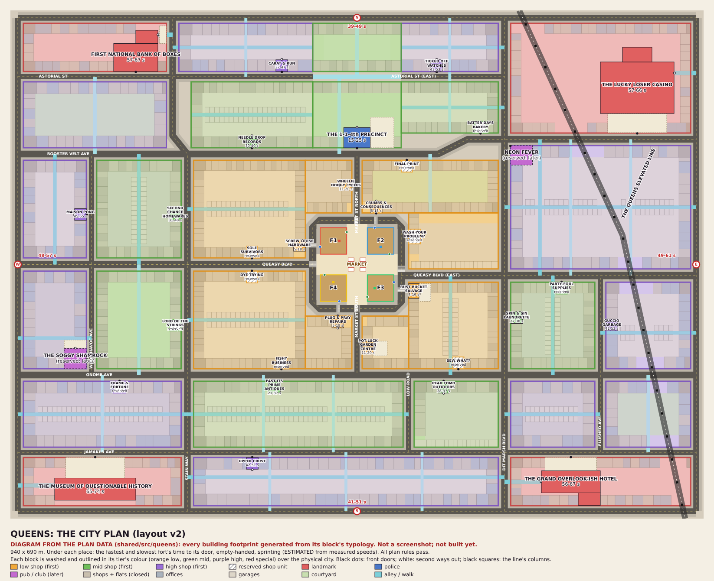
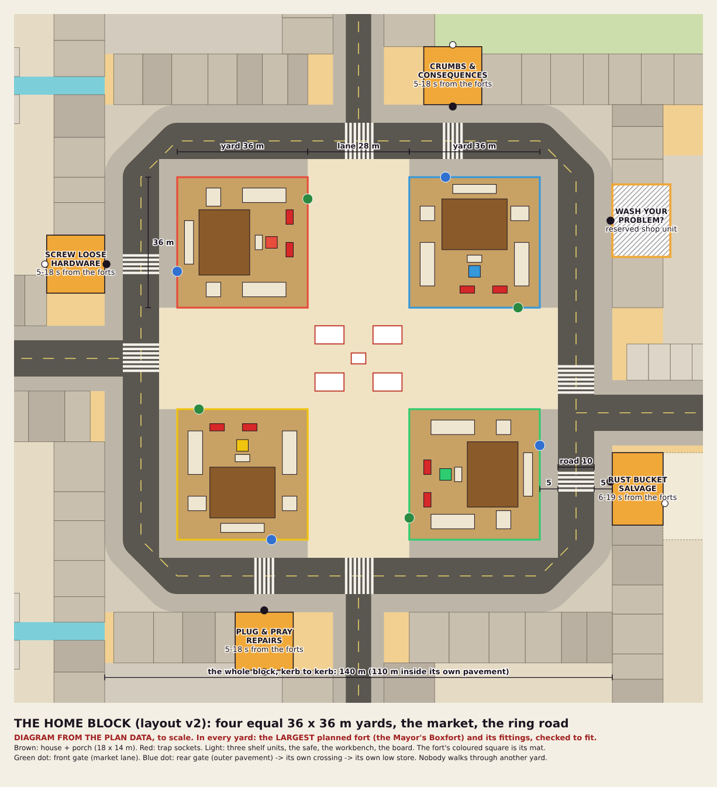
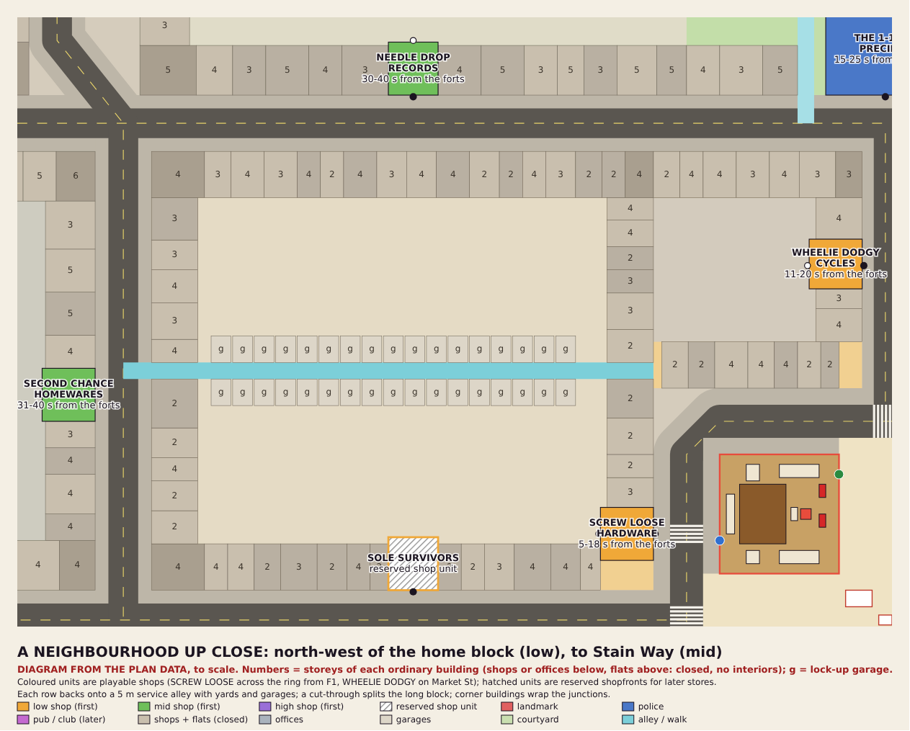

# Queens: the city plan (layout v2, generated)

Generated by `npx tsx tests/queens-plan-report.ts` from `shared/src/queens/`. Do not edit by hand. Every picture here is a **diagram from the plan data**: nothing is built yet.

**Rules:** all pass (`shared/test/queens-plan.test.ts`).

## The city in numbers

| | |
|---|---|
| playable area | 940 x 690 m; 47.3 ha of blocks |
| buildings | 1419 ordinary (419 of them lock-up garages) + 33 units (16 playable shops, 10 reserved shop units, 4 landmarks, the police, the pub, the club) |
| alleys and walks | 31 generated + 9 planned |
| building cover | 46% of block land (per block 22-63%) |
| the line | 23 columns, every road and alley crossed with a clear span of 32 m or less |

## How the times are worked out

Route lengths along the plan's pedestrian network (road centre lines, paths and the generated alleys, joined where they cross). Times use speeds **measured** with the game's own movement code: empty-handed = the sprint-held curve (573 m in 60 s on open ground) +3%; heavy 4.3 m/s; a giant dragged alone 2.65 m/s. They are **estimates** until the blockout is walked by the real movement code (`tests/route-matrix.ts`).

## Travel matrix (from each fort's mat; seconds out empty / back heavy / back with a giant)

| Place | | F1 | F2 | F3 | F4 |
|---|---|---|---|---|---|
| SCREW LOOSE HARDWARE | low | 49 m · 5 / 11 / 18 | 156 m · 17 / 36 / 59 | 169 m · 18 / 39 / 64 | 81 m · 9 / 19 / 31 |
| CRUMBS & CONSEQUENCES | low | 81 m · 9 / 19 / 31 | 49 m · 5 / 11 / 18 | 156 m · 17 / 36 / 59 | 169 m · 18 / 39 / 64 |
| RUST BUCKET SALVAGE | low | 177 m · 19 / 41 / 67 | 89 m · 9 / 21 / 34 | 57 m · 6 / 13 / 21 | 151 m · 16 / 35 / 57 |
| PLUG & PRAY REPAIRS | low | 156 m · 17 / 36 / 59 | 169 m · 18 / 39 / 64 | 81 m · 9 / 19 / 31 | 49 m · 5 / 11 / 18 |
| WHEELIE DODGY CYCLES | low | 99 m · 11 / 23 / 37 | 115 m · 12 / 27 / 43 | 187 m · 20 / 44 / 71 | 187 m · 20 / 44 / 71 |
| POT LUCK GARDEN CENTRE | low | 192 m · 20 / 45 / 72 | 192 m · 20 / 45 / 72 | 104 m · 11 / 24 / 39 | 120 m · 13 / 28 / 45 |
| SOLE SURVIVORS | low (reserved) | 152 m · 16 / 35 / 57 | 225 m · 24 / 52 / 85 | 225 m · 24 / 52 / 85 | 137 m · 15 / 32 / 52 |
| DYE TRYING | low (reserved) | 152 m · 16 / 35 / 57 | 225 m · 24 / 52 / 85 | 225 m · 24 / 52 / 85 | 137 m · 15 / 32 / 52 |
| THE FINAL PRINT | low (reserved) | 211 m · 22 / 49 / 80 | 227 m · 24 / 53 / 86 | 299 m · 32 / 70 / 113 | 299 m · 32 / 70 / 113 |
| WASH YOUR PROBLEM? | low (reserved) | 131 m · 14 / 31 / 50 | 93 m · 10 / 22 / 35 | 109 m · 12 / 25 / 41 | 181 m · 19 / 42 / 68 |
| SEW WHAT? | low (reserved) | 369 m · 39 / 86 / 139 | 281 m · 30 / 65 / 106 | 267 m · 28 / 62 / 101 | 297 m · 32 / 69 / 112 |
| FISHY BUSINESS | low (reserved) | 334 m · 36 / 78 / 126 | 334 m · 36 / 78 / 126 | 246 m · 26 / 57 / 93 | 262 m · 28 / 61 / 99 |
| SECOND CHANCE HOMEWARES | mid | 307 m · 33 / 71 / 116 | 380 m · 40 / 88 / 143 | 380 m · 40 / 88 / 143 | 292 m · 31 / 68 / 110 |
| SPIN & SIN LAUNDRETTE | mid | 354 m · 38 / 82 / 133 | 266 m · 28 / 62 / 100 | 251 m · 27 / 58 / 95 | 354 m · 38 / 82 / 133 |
| NEEDLE DROP RECORDS | mid | 286 m · 30 / 67 / 108 | 302 m · 32 / 70 / 114 | 374 m · 40 / 87 / 141 | 374 m · 40 / 87 / 141 |
| PEAK FOMO OUTDOORS | mid | 349 m · 37 / 81 / 132 | 280 m · 30 / 65 / 106 | 261 m · 28 / 61 / 99 | 277 m · 29 / 64 / 104 |
| PAST ITS PRIME ANTIQUES | mid | 344 m · 37 / 80 / 130 | 344 m · 37 / 80 / 130 | 256 m · 27 / 59 / 96 | 271 m · 29 / 63 / 102 |
| BATTER DAYS BAKERY | mid (reserved) | 316 m · 34 / 73 / 119 | 331 m · 35 / 77 / 125 | 404 m · 43 / 94 / 152 | 404 m · 43 / 94 / 152 |
| LORD OF THE STRINGS | mid (reserved) | 322 m · 34 / 75 / 121 | 394 m · 42 / 92 / 149 | 394 m · 42 / 92 / 149 | 306 m · 33 / 71 / 116 |
| PARTY FOUL SUPPLIES | mid (reserved) | 375 m · 40 / 87 / 141 | 287 m · 30 / 67 / 108 | 272 m · 29 / 63 / 103 | 375 m · 40 / 87 / 141 |
| CARAT & RUN | high | 349 m · 37 / 81 / 132 | 365 m · 39 / 85 / 138 | 437 m · 47 / 102 / 165 | 437 m · 47 / 102 / 165 |
| TICKED OFF WATCHES | high | 403 m · 43 / 94 / 152 | 419 m · 45 / 97 / 158 | 491 m · 53 / 114 / 185 | 491 m · 53 / 114 / 185 |
| MAISON PONG | high | 436 m · 47 / 101 / 164 | 508 m · 55 / 118 / 192 | 508 m · 55 / 118 / 192 | 420 m · 45 / 98 / 159 |
| GUCCIO GARBAGE | high | 493 m · 53 / 115 / 186 | 405 m · 43 / 94 / 153 | 390 m · 42 / 91 / 147 | 493 m · 53 / 115 / 186 |
| THE UPPER CRUST | high | 477 m · 51 / 111 / 180 | 477 m · 51 / 111 / 180 | 389 m · 42 / 90 / 147 | 405 m · 43 / 94 / 153 |
| FRAME & FORTUNE | high (reserved) | 481 m · 52 / 112 / 182 | 554 m · 60 / 129 / 209 | 466 m · 50 / 108 / 176 | 466 m · 50 / 108 / 176 |
| FIRST NATIONAL BANK OF BOXES | landmark | 534 m · 57 / 124 / 202 | 550 m · 59 / 128 / 207 | 622 m · 67 / 145 / 235 | 534 m · 57 / 124 / 202 |
| THE LUCKY LOSER CASINO | landmark | 528 m · 57 / 123 / 199 | 544 m · 59 / 126 / 205 | 559 m · 60 / 130 / 211 | 616 m · 66 / 143 / 233 |
| THE MUSEUM OF QUESTIONABLE HISTORY | landmark | 618 m · 67 / 144 / 233 | 690 m · 74 / 160 / 260 | 602 m · 65 / 140 / 227 | 602 m · 65 / 140 / 227 |
| THE GRAND OVERLOOK-ISH HOTEL | landmark | 625 m · 67 / 145 / 236 | 537 m · 58 / 125 / 203 | 523 m · 56 / 122 / 197 | 553 m · 60 / 129 / 209 |
| THE 1-1-4th PRECINCT | facility | 144 m · 15 / 33 / 54 | 159 m · 17 / 37 / 60 | 232 m · 25 / 54 / 87 | 232 m · 25 / 54 / 87 |
| THE SOGGY SHAMROCK | pub | 496 m · 53 / 115 / 187 | 568 m · 61 / 132 / 214 | 524 m · 56 / 122 / 198 | 480 m · 51 / 112 / 181 |
| NEON FEVER | club | 357 m · 38 / 83 / 135 | 373 m · 40 / 87 / 141 | 370 m · 39 / 86 / 140 | 445 m · 48 / 104 / 168 |
| N border | border | 369 m · 39 / 86 / 139 | 384 m · 41 / 89 / 145 | 457 m · 49 / 106 / 172 | 457 m · 49 / 106 / 172 |
| S border | border | 473 m · 51 / 110 / 178 | 473 m · 51 / 110 / 178 | 385 m · 41 / 90 / 145 | 401 m · 43 / 93 / 151 |
| E border | border | 564 m · 61 / 131 / 213 | 476 m · 51 / 111 / 179 | 461 m · 49 / 107 / 174 | 564 m · 61 / 131 / 213 |
| W border | border | 461 m · 49 / 107 / 174 | 534 m · 57 / 124 / 201 | 534 m · 57 / 124 / 201 | 446 m · 48 / 104 / 168 |

## Fairness (playable places only)

| | F1 | F2 | F3 | F4 | spread |
|---|---|---|---|---|---|
| nearest low | 5.2 | 5.2 | 6.0 | 5.2 | 0.8 s |
| nearest mid | 30.4 | 28.2 | 26.7 | 28.8 | 3.7 s |
| nearest high | 37.2 | 38.9 | 41.5 | 43.2 | 6.0 s |
| nearest landmark | 56.8 | 57.8 | 56.2 | 57.5 | 1.6 s |
| average to the 20 playable businesses | 36.7 | 36.6 | 36.4 | 36.8 | 0.4 s |
| average to the 4 borders | 50.0 | 50.0 | 49.2 | 50.0 | 0.8 s |

## The 8:00 scavenge (estimates: + 45 s robbing a store / 75 s a landmark objective, + 10 s banking)

| Fort | worst high-end heavy run | per scavenge | worst landmark run, giant dragged alone |
|---|---|---|---|
| F1 | 222 s | 2 | 388 s (81%) |
| F2 | 228 s | 2 | 420 s (87%) |
| F3 | 228 s | 2 | 387 s (81%) |
| F4 | 222 s | 2 | 384 s (80%) |

## The units

| id | kind | tier | phase | name | footprint | door | keeps id | notes |
|---|---|---|---|---|---|---|---|---|
| screwloose | shop | low | first | SCREW LOOSE HARDWARE | 16 x 16 | (-69.5, 26) | lastscrew | timber, tools, screws, tape; signature: the forty-foot ladder nobody can carry upright |
| crumbs | shop | low | first | CRUMBS & CONSEQUENCES | 16 x 16 | (26, 69.5) | crumbs | mini-mart food, packaging, batteries; signature: the pyramid of off-brand cola |
| rustbucket | shop | low | first | RUST BUCKET SALVAGE | 14 x 20 | (69.5, -34) | rustbucket | scrap metal, timber, parts; signature: the car door that still has a parking ticket; the scrap yard; specialist: a 14 x 20 office + a fenced scrap yard behind |
| plugpray | shop | low | first | PLUG & PRAY REPAIRS | 16 x 16 | (-26, -69.5) | plugpray | broken appliances, wire, electronics; signature: the microwave that only plays polka |
| wheelie | shop | low | first | WHEELIE DODGY CYCLES | 16 x 15 | (-6.5, 107) |  | bicycles, chains, wheels; signature: a tandem with one seat |
| potluck | shop | low | first | POT LUCK GARDEN CENTRE | 16 x 16 | (6.5, -112) |  | plants, gnomes, tools, garden supplies; signature: the gnome with a getaway plan; the plant yard; specialist: a 16 x 16 shop + an open plant yard |
| solesurv | shop | low | reserved | SOLE SURVIVORS | 15 x 16 | (-142.5, 8.5) |  | discount shoes, rubber, fabric |
| dyetrying | shop | low | reserved | DYE TRYING | 15 x 16 | (-142.5, -8.5) |  | hair salon, wigs, dryers, cosmetics |
| finalprint | shop | low | reserved | THE FINAL PRINT | 15 x 16 | (67.5, 142) |  | paper, ink, glue, stationery |
| washprob | shop | low | reserved | WASH YOUR PROBLEM? | 16 x 20 | (69.5, 38) |  | car wash, hoses, cleaning supplies; specialist: a drive-through wash bay |
| sewwhat | shop | low | reserved | SEW WHAT? | 15 x 16 | (137.5, -142) |  | alterations, fabric rolls, sewing machines |
| fishy | shop | low | reserved | FISHY BUSINESS | 15 x 16 | (-102.5, -142) |  | fishmonger, food, packaging, odd trophies |
| secondchance | shop | mid | first | SECOND CHANCE HOMEWARES | 16 x 16 | (-238, 68) | secondchance | furniture, lamps, appliances; signature: the sofa shaped like a mouth |
| spinsin | shop | mid | first | SPIN & SIN LAUNDRETTE | 16 x 16 | (208, -72) | spincycle | machines, lost property, clothing; signature: the lost-property bin (nobody knows what's in it) |
| needledrop | shop | mid | first | NEEDLE DROP RECORDS | 15 x 16 | (-142.5, 158) | needledrop | records, audio gear, collectibles; signature: the jukebox that only takes buttons |
| peakfomo | shop | mid | first | PEAK FOMO OUTDOORS | 15 x 16 | (117.5, -158) | peakfomo | camping gear, straps, tents; signature: the tent that's bigger inside (it isn't) |
| pastprime | shop | mid | first | PAST ITS PRIME ANTIQUES | 16 x 16 | (-112, -158) |  | clocks, furnishings, collectibles; signature: the grandfather clock that's actually a grandmother |
| batterdays | shop | mid | reserved | BATTER DAYS BAKERY | 15 x 16 | (167.5, 178) |  | food, cookware, kitchen appliances |
| strings | shop | mid | reserved | LORD OF THE STRINGS | 16 x 15 | (-238, -82.5) |  | instruments, amplifiers, an oversized tuba |
| partyfoul | shop | mid | reserved | PARTY FOUL SUPPLIES | 15 x 16 | (277.5, -23.5) |  | costumes, decorations, novelty props |
| caratrun | shop | high | first | CARAT & RUN | 16 x 16 | (-102, 261.5) | caratrun | jewellery and extravagant display pieces; signature: the DIAMOND PIGEON |
| tickedoff | shop | high | first | TICKED OFF WATCHES | 16 x 16 | (108, 261.5) | tickedoff | watches and precision parts; signature: the cuckoo clock that sounds the alarm itself |
| maisonpong | shop | high | first | MAISON PONG | 16 x 16 | (-366.5, 68) | maisonpong | perfume and luxury cosmetics; signature: EAU DE BIN, the flagship scent |
| guccio | shop | high | first | GUCCIO GARBAGE | 16 x 16 | (337, -82) |  | designer fashion and accessories; signature: the handbag made of a real bin bag ($900) |
| uppercrust | shop | high | first | THE UPPER CRUST | 16 x 16 | (-142, -261.5) |  | luxury deli, cheese vault, giftware; signature: the wheel of cheese with its own security guard |
| framefort | shop | high | reserved | FRAME & FORTUNE | 16 x 16 | (-322, -158) |  | art, sculptures, prestige objects |
| bank | landmark |  | first | FIRST NATIONAL BANK OF BOXES | 60 x 38 + 30 x 18 | (-300, 261.5) |  | a corner banking hall on Astorial St; the counting room and the vault behind; the armoured-van dock on the gated service side; signature: the vault door on a novelty key ring; the armoured-van dock (gated) |
| casino | landmark |  | first | THE LUCKY LOSER CASINO | 100 x 70 + 40 x 20 | (380, 178) |  | a lit marquee facing the club across Rooster Velt Ave; the floor (no real-money games); the cash office at the back; signature: the slot machine that pays out in coupons; the marquee forecourt |
| museum | landmark |  | first | THE MUSEUM OF QUESTIONABLE HISTORY | 110 x 30 | (-355, -261.5) |  | a columned front up steps from a public forecourt on Jamaker Ave; the galleries; the goods yard round the back; signature: a dinosaur made of shopping trolleys; the public forecourt + steps |
| hotel | landmark |  | first | THE GRAND OVERLOOK-ISH HOTEL | 80 x 30 + 30 x 17 | (290, -261.5) |  | a canopy and a drop-off lay-by on Jamaker Ave; the lobby, service corridors, a few guest floors, the penthouse; signature: the luggage trolley piled with someone's whole life; the canopy drop-off |
| police | facility |  | first | THE 1-1-4th PRECINCT | 36 x 27.5 | (0, 158) |  | a corner station facing down Market St; the cells and the impound yard behind; the impound yard |
| pub | pub |  | reserved | THE SOGGY SHAMROCK | 30 x 27.5 | (-366.5, -128) |  | the Irish pub: the bar, the snug, upstairs pool + darts, the cantilever balcony over Wood Havoc; WEE MICKEY's yard (the black market); moves here in a later stage (Blake): footprint reserved for today's interior |
| club | club |  | reserved | NEON FEVER | 29.5 x 26.5 | (208, 161) |  | the club: its corner door on the junction, the atrium, the roof deck; DON BINNIE's lounge; the fire exit onto the club lane; moves here in a later stage (Blake): footprint reserved for today's interior |

## Floor areas (R15: about twice today's stores; today's average plot 115 m2, ~103 m2 of floor)

| store | tier | phase | footprint | usable | x today's | flag |
|---|---|---|---|---|---|---|
| SCREW LOOSE HARDWARE | low | first | 16 x 16 | 237 m2 | 2.31 |  |
| CRUMBS & CONSEQUENCES | low | first | 16 x 16 | 237 m2 | 2.31 |  |
| RUST BUCKET SALVAGE | low | first | 14 x 20 | 260 m2 | 2.54 | specialist: a 14 x 20 office + a fenced scrap yard behind |
| PLUG & PRAY REPAIRS | low | first | 16 x 16 | 237 m2 | 2.31 |  |
| WHEELIE DODGY CYCLES | low | first | 16 x 15 | 222 m2 | 2.16 |  |
| POT LUCK GARDEN CENTRE | low | first | 16 x 16 | 237 m2 | 2.31 | specialist: a 16 x 16 shop + an open plant yard |
| SOLE SURVIVORS | low | reserved | 15 x 16 | 222 m2 | 2.16 |  |
| DYE TRYING | low | reserved | 15 x 16 | 222 m2 | 2.16 |  |
| THE FINAL PRINT | low | reserved | 15 x 16 | 222 m2 | 2.16 |  |
| WASH YOUR PROBLEM? | low | reserved | 16 x 20 | 299 m2 | 2.91 | specialist: a drive-through wash bay |
| SEW WHAT? | low | reserved | 15 x 16 | 222 m2 | 2.16 |  |
| FISHY BUSINESS | low | reserved | 15 x 16 | 222 m2 | 2.16 |  |
| SECOND CHANCE HOMEWARES | mid | first | 16 x 16 | 237 m2 | 2.31 |  |
| SPIN & SIN LAUNDRETTE | mid | first | 16 x 16 | 237 m2 | 2.31 |  |
| NEEDLE DROP RECORDS | mid | first | 15 x 16 | 222 m2 | 2.16 |  |
| PEAK FOMO OUTDOORS | mid | first | 15 x 16 | 222 m2 | 2.16 |  |
| PAST ITS PRIME ANTIQUES | mid | first | 16 x 16 | 237 m2 | 2.31 |  |
| BATTER DAYS BAKERY | mid | reserved | 15 x 16 | 222 m2 | 2.16 |  |
| LORD OF THE STRINGS | mid | reserved | 16 x 15 | 222 m2 | 2.16 |  |
| PARTY FOUL SUPPLIES | mid | reserved | 15 x 16 | 222 m2 | 2.16 |  |
| CARAT & RUN | high | first | 16 x 16 | 237 m2 | 2.31 |  |
| TICKED OFF WATCHES | high | first | 16 x 16 | 237 m2 | 2.31 |  |
| MAISON PONG | high | first | 16 x 16 | 237 m2 | 2.31 |  |
| GUCCIO GARBAGE | high | first | 16 x 16 | 237 m2 | 2.31 |  |
| THE UPPER CRUST | high | first | 16 x 16 | 237 m2 | 2.31 |  |
| FRAME & FORTUNE | high | reserved | 16 x 16 | 237 m2 | 2.31 |  |

## Blocks

| block | tier | typology | land | built |
|---|---|---|---|---|
| B_nw | low | row | 2.46 ha | 44% |
| B_ne | low | courtyard | 1.32 ha | 46% |
| B_e | low | workshop | 0.92 ha | 22% |
| B_se | low | row | 1.88 ha | 48% |
| B_sw | low | row | 2.46 ha | 44% |
| B_w3 | mid | row | 1.52 ha | 51% |
| B_w4 | mid | courtyard | 1.52 ha | 42% |
| B_n2 | mid | row | 1.48 ha | 53% |
| B_n4 | mid | row | 0.91 ha | 48% |
| B_e2 | mid | row | 1.34 ha | 53% |
| B_s3 | mid | row | 2.54 ha | 52% |
| B_s4 | mid | workshop | 1.02 ha | 37% |
| B_w1 | high | row | 1.13 ha | 51% |
| B_pub | high | destination | 1.13 ha | 51% |
| B_nw1 | high | courtyard | 1.74 ha | 45% |
| B_n5 | high | row | 1.19 ha | 52% |
| B_n6 | high | row | 0.86 ha | 53% |
| B_club | high | destination | 4.09 ha | 31% |
| B_e3 | high | row | 1.35 ha | 41% |
| B_sw1 | high | row | 1.92 ha | 56% |
| B_s6 | high | row | 2.71 ha | 51% |
| B_s5 | high | row | 1.02 ha | 63% |
| B_s7 | high | courtyard | 1.03 ha | 42% |
| B_police | mid | civic | 1.86 ha | 37% |
| B_bank | special | precinct | 1.27 ha | 58% |
| B_casino | special | precinct | 3.64 ha | 43% |
| B_museum | special | precinct | 1.40 ha | 54% |
| B_hotel | special | precinct | 1.60 ha | 49% |

## Materials (playable shops)

| material | sources |
|---|---|
| timber | SCREW LOOSE HARDWARE, RUST BUCKET SALVAGE, POT LUCK GARDEN CENTRE, SECOND CHANCE HOMEWARES, PAST ITS PRIME ANTIQUES, THE MUSEUM OF QUESTIONABLE HISTORY |
| metal | SCREW LOOSE HARDWARE, RUST BUCKET SALVAGE, PLUG & PRAY REPAIRS, WHEELIE DODGY CYCLES, SPIN & SIN LAUNDRETTE, PEAK FOMO OUTDOORS, PAST ITS PRIME ANTIQUES, CARAT & RUN, TICKED OFF WATCHES, FIRST NATIONAL BANK OF BOXES, THE LUCKY LOSER CASINO, THE MUSEUM OF QUESTIONABLE HISTORY |
| fabric | CRUMBS & CONSEQUENCES, SECOND CHANCE HOMEWARES, SPIN & SIN LAUNDRETTE, PEAK FOMO OUTDOORS, GUCCIO GARBAGE, THE GRAND OVERLOOK-ISH HOTEL |
| fasteners | SCREW LOOSE HARDWARE, RUST BUCKET SALVAGE, PLUG & PRAY REPAIRS, WHEELIE DODGY CYCLES, TICKED OFF WATCHES |
| electronics | CRUMBS & CONSEQUENCES, PLUG & PRAY REPAIRS, SECOND CHANCE HOMEWARES, SPIN & SIN LAUNDRETTE, NEEDLE DROP RECORDS, TICKED OFF WATCHES, THE LUCKY LOSER CASINO, THE GRAND OVERLOOK-ISH HOTEL |
| rubber | RUST BUCKET SALVAGE, WHEELIE DODGY CYCLES, POT LUCK GARDEN CENTRE, PEAK FOMO OUTDOORS, GUCCIO GARBAGE |
| chemicals | SCREW LOOSE HARDWARE, POT LUCK GARDEN CENTRE, MAISON PONG |
| luxury | NEEDLE DROP RECORDS, PAST ITS PRIME ANTIQUES, CARAT & RUN, TICKED OFF WATCHES, MAISON PONG, GUCCIO GARBAGE, THE UPPER CRUST, FIRST NATIONAL BANK OF BOXES, THE LUCKY LOSER CASINO, THE MUSEUM OF QUESTIONABLE HISTORY, THE GRAND OVERLOOK-ISH HOTEL |
| food | CRUMBS & CONSEQUENCES, THE UPPER CRUST |

Loot value per cycle (proposed shares; Stage 3 tunes): low 22%, mid 28%, high 30%, landmark 20%. More shops split the same budget.

## How much city is in view (a PLANNING PROXY, not a rendering measurement)

Buildings whose centre is within the fog's reach (240 m by day, 150 m at night) of points every 25 m along every street, against the same count on today's new map. Today's city is merged per tile, so what a view costs is tiles x materials, not buildings; but the triangles, the shadows and the silhouettes do grow with this.

| | buildings in the city | in view by day (worst / average) | at night (worst / average) |
|---|---|---|---|
| today's new map | 131 | 131 / 131 | 131 / 103 |
| Queens v2 | 1455 | 541 / 307 | 240 / 131 |

The worst spot is near the home block (-85, 0). See `perf.md` for what this means for the budgets.

## The line

- crosses queasy_e: 32 m clear span
- crosses rooster: 32 m clear span
- crosses gnome: 32 m clear span
- crosses jamaker: 32 m clear span
- crosses border_n: 21 m clear span
- crosses border_s: 19 m clear span
- crosses al_B_club: 32 m clear span
- crosses cut_B_club_2: 32 m clear span
- crosses al_B_e3: 32 m clear span
