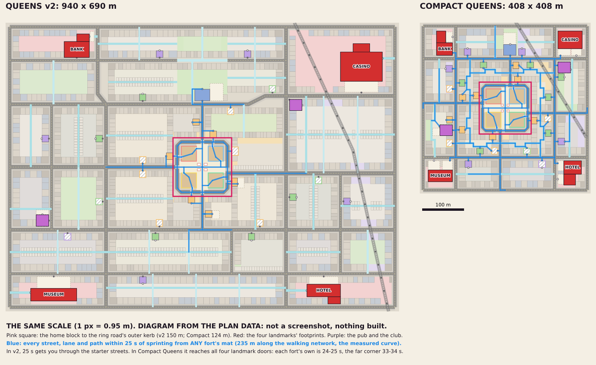
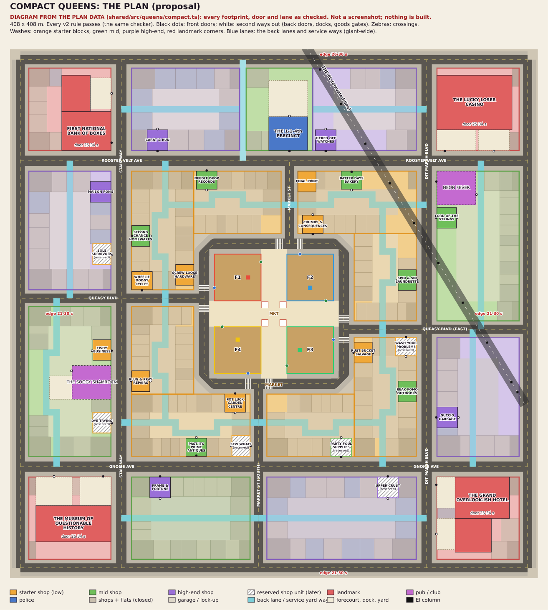
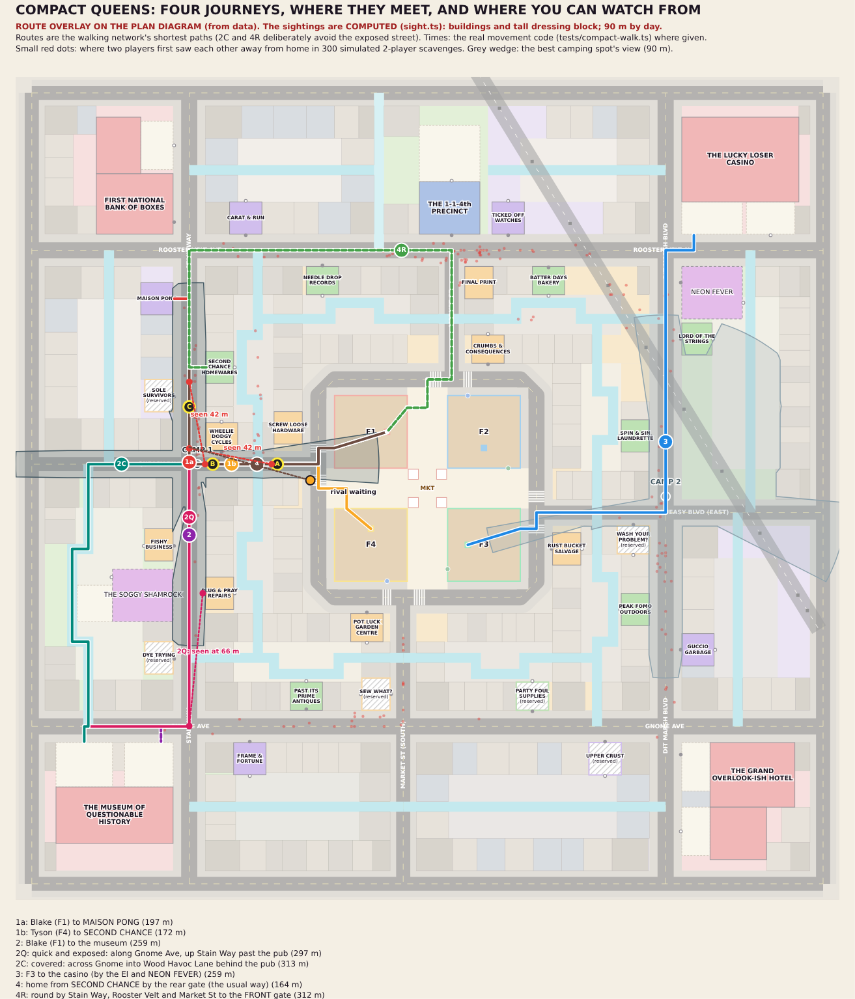
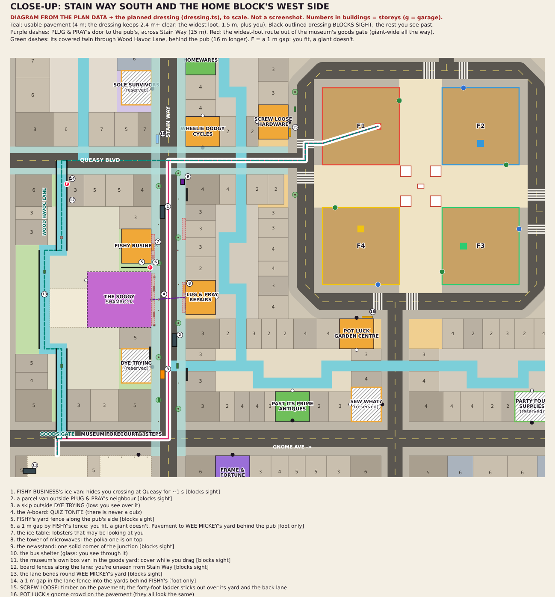
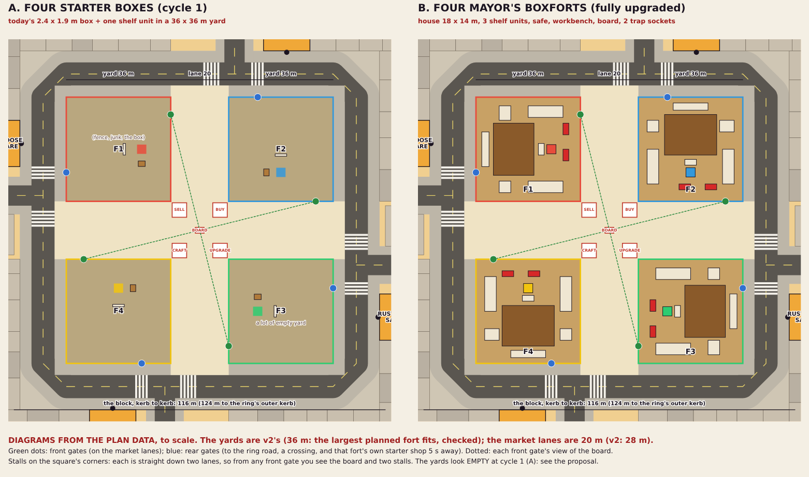
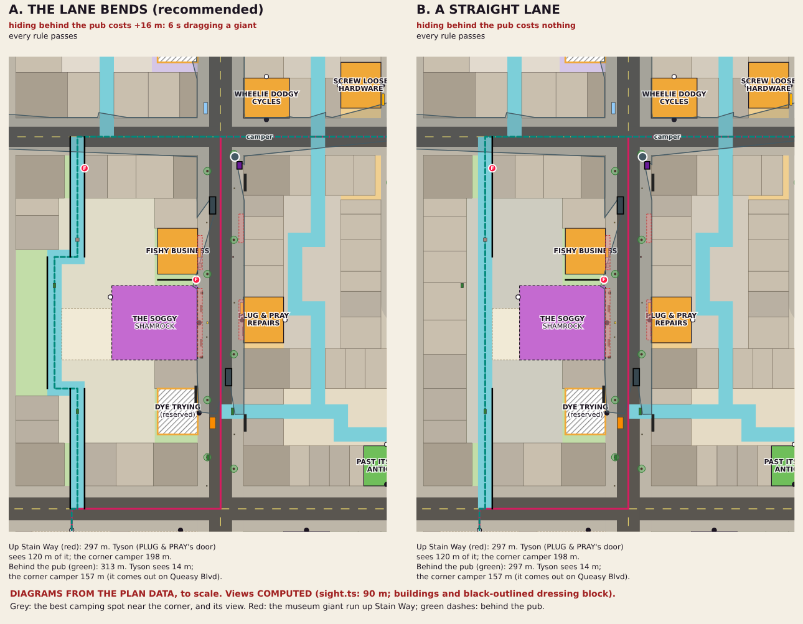
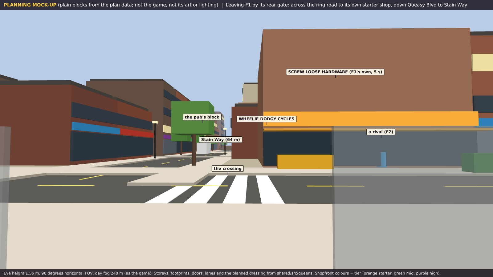
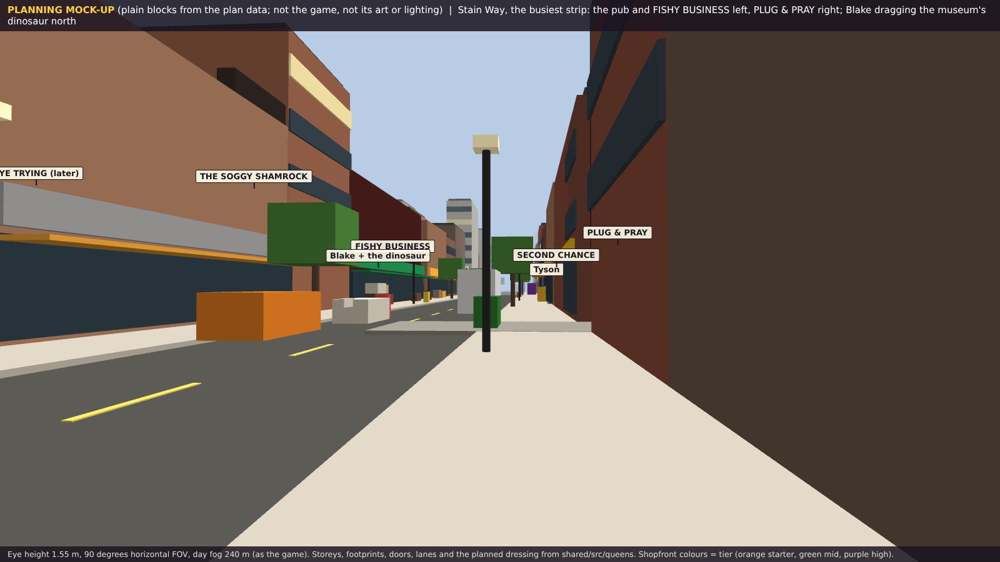
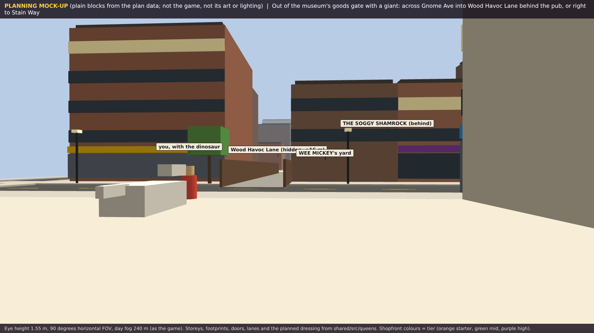
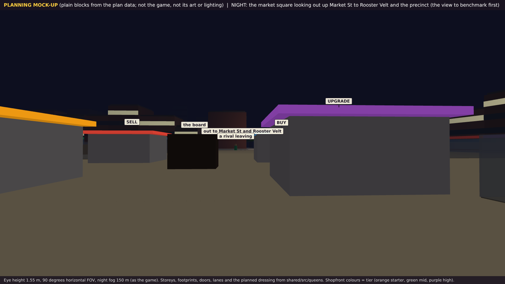

# Compact Queens: the proposal (2026-11-17)

Blake's brief: a substantially smaller, denser Queens; your nearest major landmark in about 25 s; more shops on the
streets players use; more chances to see another bandit and decide what to do about it. **A proposal for review: the
playable city is unchanged.** Baseline: `main` at **9d43e9d** (Queens v2, layout Q1.1).

What every picture is: **diagram from the plan data** (drawn from `shared/src/queens/compact.ts`, checked by the same
rules as v2), **route overlay** (journeys and computed sightlines on the diagram), or **planning mock-up** (plain blocks
from the same data at player height; not the game's art, lighting or renderer). Nothing here is a game screenshot.

| | |
|---|---|
|  |  |
| 01 v2 and Compact at the same scale | 02 the plan, labelled |
|  |  |
| 03 four journeys, where they meet, the camping spot | 04 Stain Way south with its dressing |
|  |  |
| 05 the home block: starter boxes / largest forts | 06 the one hard choice: the pub's lane |
|  |  |
| 07 mock-up: leaving a starter fort | 08 mock-up: the busiest shopping street |
|  |  |
| 09 mock-up: a giant out of the museum | 10 mock-up: the market at night (the view to benchmark) |

## The short version

- **408 x 408 m** (v2: 940 x 690 m): a quarter of the area, the same home block, the same 16 + 4 stores and the pub and
  the club, plus four more stores brought forward.
- **Every fort's nearest landmark: 24.0 s** from its mat to the landmark's public door (the game's own movement code
  walking the route, sprint held, real stamina; the route model says 24.9 s). The next landmark 24.8 s, the one after
  26.7 s, the far corner 33.2 s. v2: 54-56 s to the nearest.
- **The shape:** four shopping avenues in a loop round the home block, a landmark outside each corner. Every landmark run
  uses two avenues, so runs to different places share the same strips, corners and crossings.
- **Encounters (a planning simulation, sight.ts):** two players see each other away from home in **51%** of
  scavenges (v2: 35%); carrying something and close enough to tell what, 39% (v2: 25%). Four players: 98% (v2: 93%), about
  4.3 sightings a scavenge. The best camping spot is a shopping-street corner, not a fort gate.
- **Earnings: the shelves cap them, not the distance.** At the starting 8 shelves a player banks the same as in v2 (two
  high-end runs fill them) but in 3.5 minutes instead of 4.5-7.5. With 16 shelves, +20-25%. No price changes before a
  playtest; the freed minutes go to fights, theft, quests and second looks.

## 1. Two players, one round

The city is built round the encounter Blake described. Blake (F1) robs the museum; Tyson (F4) goes for electronics at
PLUG & PRAY. Their trips have different goals and overlap on one street: **Stain Way, the west shopping street**, where
the museum's way home passes the repair shop, the fishmonger and the pub.

What the plan gives them (computed, `tests/compact-report.ts`, timings from the real movement code where marked):
- Blake: mat to the museum's door 26.7 s; 75 s inside (assumed); out of the GOODS GATE with the trolley dinosaur (a giant,
  2.65 m/s). Tyson leaves a minute later, 45 s inside PLUG & PRAY.
- As Tyson comes out (t = 125 s), Blake is at the Gnome Ave / Stain Way corner **63-66 m** down the street, dragging
  something enormous. They see each other; each can tell what the other is carrying.
- Blake's choices, then: keep going up Stain Way (297 m home, Tyson sees 120 m of it), **duck behind the pub** through
  Wood Havoc Lane (313 m: +16 m, about 6 s with a giant; Tyson sees 14 m of it, where it crosses Gnome Ave), or wait in
  the goods yard behind the museum's own box van. Tyson's: follow (he's empty-handed: three times Blake's speed), cut
  him off at the Queasy Blvd corner (the strongest camping spot, below), or carry on with his own loot.
- If Blake takes the lane from the start, Tyson never sees him. That's the point: **cover exists, it costs a few
  seconds, and you choose it.**

Four players use the same streets: 98% of simulated scavenges have a sighting away from home, the first one about 70 s
in (median). More of them happen at the perimeter too (3.2 a scavenge vs v2's 1.5): the forts are closer together.

## 2. The size: from the 25 s trip, not the border

**The benchmark** (Blake's): each fort's banking mat to the public entrance of its nearest major landmark, empty-handed,
sprint held under the real stamina rules, legal pedestrian route. Target ~25 s (22-28 s).

**How the size falls out of it.** A fort's quickest way to "its" landmark is: the mat to the rear gate (27 m), across
the ring road, along the spoke to the avenue, up the avenue to the corner, to the door 14 m past it. With the loop's
centre line at A metres from the middle, that's 2A - 0.5 m; 25 s is 235 m on the measured curve, so **A = 118 m**. The
avenues' far side is one band of buildings (the landmarks, the high-end shops, the pub, the club) to an edge road at
196 m. The border lands at 21-36 s from the forts, wherever the neighbourhood ends.

**All four forts x all four landmarks** (the game's movement code walking each route, no collisions yet; heavy = an Old
CRT TV home by the quicker door; giant = the Broken Arcade Machine home by the landmark's loading side):

| Out empty / home heavy / home giant (s) | BANK (NW) | CASINO (NE) | MUSEUM (SW) | HOTEL (SE) |
|---|---|---|---|---|
| F1 (NW) | **24.0** / 53 / 100 | 24.8 / 55 / 103 | 26.7 / 59 / 109 | 33.2 / 73 / 133 |
| F2 (NE) | 26.7 / 59 / 109 | **24.0** / 53 / 100 | 33.2 / 73 / 133 | 24.8 / 55 / 103 |
| F3 (SE) | 33.2 / 73 / 133 | 26.7 / 59 / 109 | 24.8 / 55 / 103 | **24.0** / 53 / 100 |
| F4 (SW) | 24.8 / 55 / 103 | 33.2 / 73 / 133 | **24.0** / 53 / 101 | 26.7 / 59 / 109 |
| v2, for comparison | 55.6-65.0 | 54.9-64.5 | 62.7-72.4 | 54.3-65.3 |

Every fort is the same: its own corner 24.0 s, the two either side 24.8 and 26.7 s, the far corner 33.2 s. Out, the
landmarks are close together; **home is where they differ**: the far corner's giant is 33 s slower than your own's.
I'd keep it: "which landmark" is decided by what's in it and who's there, and the far one costs you on the way back.

**What was removed or consolidated (v2 -> Compact):**
- v2's second and third rings of blocks (the mid and high districts between the starter streets and the landmarks)
  are gone; their shops moved onto the loop's two sides (mid inside, high-end outside).
- Ten avenues and side streets became four avenues, four spokes and four edge roads.
- Shop frontages shortened: v2's 120-280 m blocks are 50-100 m strips; on Stain Way a door you can use every 20-55 m.
- Streets do several jobs: each avenue is a shopping strip, a landmark approach and the cross-town route.
- Kept at full size: the home block (36 m yards: the largest planned fort fits, checked), every store's 2x floor area
  (checked), the pub's and the club's footprints for today's interiors (30 x 26 m: upstairs pool fits as it does now),
  the landmarks (smaller plots than v2 but bigger than today's buildings: 38 x 30 m halls and up).
- Bulky loot: every playable door opens onto a 3-4 m pavement; the dressing keeps 2.4 m clear (the widest giant is 1.5 m
  across, plus you); every landmark has a giant-wide loading side 38 m on from its front door; the back lanes are 5 m.
  Corners: pavements meet at 4 x 4 m or more. Crossing a road: zebras on the ring, 8 m carriageways elsewhere.

## 3. The centre and the four sides

**The home block** (img 05): v2's four 36 x 36 m yards, front gates on the market lanes, rear gates to the ring road,
screened mats (9 m+ from either gate), 10 s banking, the Mayor's Boxfort laid out and checked to fit.
- **The market lanes are 20 m, not 28 m.** On a smaller map the market should feel like a street market, not a car
  park: 20 m fits a stall each side of a 10 m walkway; the square where they cross is 20 x 20 m.
- **The stalls sit on the square's four corners** (SELL / BUY / CRAFT / UPGRADE), the board in the middle: from any front
  gate, at eye height, you see the board straight down your lane and two stalls framing it.
- **The spokes are offset 12 m from the lanes, all turning the same way** (a pinwheel), so there's no straight sightline
  across the market from one avenue to the other, and every fort's trips have the same shape.
- **With four starter boxes the yards look empty** (img 05 A): a 2.4 x 1.9 m box in a 36 x 36 m yard. Recommendation:
  dress the starter yard as a junk lot (a chain-link fence, pallets, a skip, a sofa) that the upgrades replace. The
  yards are the size of the finished fort; that's the cost of keeping the Mayor's Boxfort.

**Tiers, by street:** starter shops face the ring road (each fort's own, 5.0 s from its mat, through its rear gate)
and the spokes; mid shops on the inside of the loop; high-end shops and the landmarks on the outside. They overlap
on purpose: PLUG & PRAY (starter) is on Stain Way among the mid shops; THE FINAL PRINT (starter) is on Market St at the
precinct end.

**How you know where you are with the map closed:**
- **West, Stain Way (worn):** the pub's green front with its balcony over the pavement; FISHY BUSINESS's fibreglass
  marlin; the microwave tower outside PLUG & PRAY. **The museum's goods gate is across Gnome Ave from the end of the
  Shamrock's back lane**; the museum's columns close the street's south end, the bank's hall its north end.
- **North, Rooster Velt (uptown):** the precinct faces straight down Market St (you see its blue lamp from the market's
  north exit); jewellery and watch windows; the El crosses overhead at the east end.
- **East, Dit Marsh (nightlife, under the El):** the El's steel crosses Dit Marsh 64 m south of the junction and Rooster Velt 39 m west of it;
  **from NEON FEVER's door you see the casino's marquee across the junction** and the El's columns behind you; LORD OF
  THE STRINGS' tuba in the window next door; the laundrette lit all night.
- **South, Gnome Ave (established):** the hotel's 10 storeys show over the roofs from most of the city (the tallest
  thing); FRAME & FORTUNE and PAST ITS PRIME face the museum's forecourt; POT LUCK's crowd of identical gnomes is on the
  ring road outside F4.
- **The El** is your compass: it runs from the north edge to the east edge across the NE corner; if it's overhead,
  you're on the casino side.

## 4. Shops where players go

**The roster:** 26 shops planned (12 / 8 / 6) as in v2. **Recommended first release: 20 (8 / 7 / 5)**, v2's 16 plus four
brought forward, each because a street needed it:
- **FISHY BUSINESS** (starter): next to the pub on Stain Way, on the museum run's way home (food for recipes; a quick
  stop that costs you 6-10 s in full view of the street).
- **THE FINAL PRINT** (starter): on Market St at the precinct end: stupid junk (paper, glue, a bum-copying photocopier)
  with the cops watching.
- **BATTER DAYS BAKERY** (mid): on Rooster Velt, the cops' doughnut supply, a step from the precinct.
- **LORD OF THE STRINGS** (mid): next door to NEON FEVER under the El; the tuba bigger than the door it leaves by.
- (FRAME & FORTUNE swaps with THE UPPER CRUST so the museum corner has a high-end shop: art next to the museum.)

Still reserved (closed shopfronts until their turn): SOLE SURVIVORS, DYE TRYING, WASH YOUR PROBLEM?, SEW WHAT?, PARTY FOUL,
THE UPPER CRUST.

**Shopping street 1: STAIN WAY** (the west side; museum to bank; the busiest: img 04, 08), south to north:

| Stain Way | West side (backs onto Wood Havoc Lane) | East side (backs onto the SW / NW back lanes) |
|---|---|---|
| the Gnome Ave corner | THE MUSEUM: forecourt and steps; the goods gate round the corner on Gnome Ave | shops + flats, a skip |
| | DYE TRYING (reserved) | shops + flats |
| opposite each other | **THE SOGGY SHAMROCK** (benches, barrels, the QUIZ TONITE board; WEE MICKEY's yard behind) | **PLUG & PRAY REPAIRS** (the microwave tower) |
| a 1 m gap: foot only | **FISHY BUSINESS** (the marlin, the ice table) | shops + flats, the parcel van |
| the Queasy Blvd corner | bus shelter (glass) | the newsstand; **WHEELIE DODGY CYCLES** round the corner on Queasy |
| | SOLE SURVIVORS (reserved) | **SECOND CHANCE HOMEWARES** (the mouth sofa on the pavement) |
| | **MAISON PONG** (a giant atomiser over the door) | shops + flats |
| the Rooster Velt corner | THE BANK: its hall on the corner, the van dock 38 m on | NEEDLE DROP round the corner on Rooster Velt |

**Shopping street 2: ROOSTER VELT AVE** (the north side; bank to casino), west to east:

| Rooster Velt | North side (backs onto its own service alley) | South side (backs onto the NW / NE back lanes) |
|---|---|---|
| the Stain Way corner | the bank's van dock | shops + flats |
| | **CARAT & RUN** (the DIAMOND PIGEON) | **NEEDLE DROP RECORDS** |
| the footpath to the shore | THE 1-1-4th PRECINCT, facing down Market St | Market St comes in (THE FINAL PRINT on it) |
| | **TICKED OFF WATCHES** (a street clock that runs backwards) | **BATTER DAYS BAKERY** |
| under the El | the El's columns | the El's columns, a car park under it |
| the Dit Marsh corner | THE CASINO's marquee forecourt | NEON FEVER across Dit Marsh |

**Decisions the extra shops create:** FISHY BUSINESS on the way home from the museum (a 10 s stop for a recipe's food,
in view of the pub's windows); TICKED OFF and CARAT & RUN on the way to the bank or the casino (a high-end haul without
the landmark's security, or the landmark's giant); LORD OF THE STRINGS under the El (the tuba: a giant you can get to in
19 s, slow home); SCREW LOOSE's forty-foot ladder over the back lane: you know where you are from behind.

## 5. Earnings: estimated, before any change

`tests/compact-economy.ts` plans each player's 8:00 to bank the most value (a dynamic programme over time and free
shelf slots), shared stock, R15's shelf tables (from the R15 branch: not on main yet), landmarks with a PLACEHOLDER haul
(not designed yet). Banked value per player per scavenge (before selling at 60%):

| Fort shelves | v2, 1 / 2 / 4 players | Compact, 1 / 2 / 4 players | Time used (Compact vs v2) |
|---|---|---|---|
| 8 (the start) | $1,600 / $1,500 / $1,394 | $1,600 / $1,500 / $1,418 | 156-334 s vs 201-460 s |
| 12 | $2,400 / $2,240 / $1,851 | $2,400 / $2,250 / $2,103 | |
| 16 | $2,575 / $2,647 / $2,269 | $3,200 / $3,000 / $2,739 | |

- **The shelves are the cap, not the distance.** A trip carries up to four things (hands + three pockets); the starting
  8 shelves fill in two trips on either map. Compact doesn't multiply what you bank; it gives you back 1-4 minutes of
  the scavenge. With bigger shelves it's worth +11% (12) to +20-25% (16).
- **What the best play does with it:** two or three runs to the best high-end shop near you (jewellery and perfume are
  small, valuable, pocketable). Starter junk is never worth a shelf slot at 8 shelves, on either map. "Heaps of stupid
  junk early" needs a reason: recipes that want junk categories, aura tasks, the wanted list. That's an economy question
  for Stage 3, not the map's.
- **Recommendation: no price changes now.** Measure in the playable test: what players do with the spare minutes
  (fights, theft at night, quests, a second look at a shop), and whether 8 shelves fill too fast.

## 6. Clutter that plays

Principles (all in `shared/src/queens/dressing.ts`, placed for play): parked vans hide a crossing player for a second or
two, never a whole street; kiosks and board fences block sight; bins, crates, trees, hydrants, awnings, lamp posts and El
columns don't (you see over or past them standing up); every pavement keeps 2.4 m clear; foot-only gaps are 1 m (you fit,
a giant doesn't); the El's columns stand in a 7 m strip of car parks and yards, never on a pavement or a door.

The close-up (img 04) marks the usable pavement, the sightline across Stain Way (PLUG & PRAY's door to the pub's, 15 m),
the widest-loot route out of the museum (giant-wide all the way) and its covered twin, and every placed item with what it
does. **The busiest view to benchmark first:** the market at night looking out up Market St (img 10: four lit stalls, the
board, the shopfronts of Rooster Velt, the precinct). Second: the NE corner under the El (the deck, its columns, NEON
FEVER's sign, the casino's marquee). By the planning proxy the worst spot is on the ring road's east side.

## 7. Routes that overlap and separate (img 03)

1. **Two forts, two shops:** Blake (F1) to MAISON PONG, Tyson (F4) to SECOND CHANCE, leaving together. **They see each
   other on Stain Way at 51-59 s, 42 m apart** (Blake heading north, Tyson at the Queasy corner), then again as both head
   home. Shared street: Queasy Blvd from the ring to Stain Way (marks A-B), and Stain Way north of the corner (C).
2. **The museum:** in by the front door (26.7 s); out of the goods gate with a giant. **2Q** (quick, exposed): along Gnome
   Ave and up Stain Way past the pub, 297 m, about 110 s; Tyson at PLUG & PRAY sees 120 m of it. **2C** (covered): across
   Gnome Ave into Wood Havoc Lane behind the pub, 313 m (+6 s); seen for 14 m. Both are giant-wide.
3. **The casino from F3:** out of the rear gate, along Queasy Blvd (east) to Dit Marsh, north past PEAK FOMO and SPIN &
   SIN, under the El (the steel overhead: you're on the casino side), past LORD OF THE STRINGS' tuba and NEON FEVER's corner
   door, and the marquee across the junction. 259 m, 26.7 s.
4. **A rival at the perimeter:** home from SECOND CHANCE with something big, Blake reaches the Queasy corner and sees
   Tyson waiting at the market's west exit, 60 m off. Push on to the rear gate (164 m, in full view), or **go round** by
   Stain Way, Rooster Velt and Market St to the FRONT gate (312 m, +25 s carrying; in his view only for the last 59 m), or
   wait behind the corner until he moves.

**The strongest camping spot** (searched: the most of every simulated trip away from home within 90 m): **the Queasy Blvd
/ Stain Way corner**, seeing 25% of all trip positions away from home. Second: the same corner on the east side (Dit Marsh /
Queasy Blvd East), 23%. What limits them: the corner buildings cut the view into the inner blocks and down the back lanes;
90 m covers half of Stain Way; the parcel van and the newsstand hide the pavement directly behind them; and the corner can
be seen from both avenues, so the camper is the most visible person on the street. **No fort gate is in the top spots.**

## 8. The one hard choice: the pub's back lane (img 06)

**A, recommended: the lane bends round WEE MICKEY's yard**, so hiding behind the pub costs 16 m (6 s with a giant). Coming
out of the museum you decide: the street (quicker, Tyson can see you coming for 120 m) or the lane (slower, unseen until
it comes out on Queasy Blvd). Tyson can't be sure which you'll take, so he has to pick a spot.

**B: a straight lane**, hiding costs nothing. Everyone with a giant goes behind the pub every time; Stain Way is for
empty-handed runners; the encounter becomes "camp the lane's mouth on Queasy Blvd". It's the same picture with no
decision in it.

Tested and dropped as choices: a dog-leg where Queasy Blvd crosses Stain Way (no measurable change to the encounter rate
or the corner camper's view: few trips use Queasy west of Stain Way), and a busier corner (a scaffold and a lorry: the
museum runner was in view 215 m instead of 218 m). Neither is worth the complication.

## 9. The travel table (all four forts)

| | F1 | F2 | F3 | F4 |
|---|---|---|---|---|
| nearest starter shop | SCREW LOOSE 5.0 s | CRUMBS 5.0 s | RUST BUCKET 5.0 s | POT LUCK 5.0 s |
| nearest mid shop | SECOND CHANCE 16.4 s | SPIN & SIN 16.1 s | SPIN & SIN 15.3 s | PAST ITS PRIME 16.4 s |
| nearest high-end shop | TICKED OFF 15.2 s | TICKED OFF 14.3 s | GUCCIO GARBAGE 18.6 s | FRAME & FORTUNE 19.4 s |
| BANK / CASINO / MUSEUM / HOTEL | 24.0 / 24.8 / 26.7 / 33.2 s | 26.7 / 24.0 / 33.2 / 24.8 s | 33.2 / 26.7 / 24.8 / 24.0 s | 24.8 / 33.2 / 24.0 / 26.7 s |

The game's own movement code walked each route, sprint held, real stamina, **no collisions yet** (no buildings exist):
corners and kerbs will add a little in the blockout. The route model's estimates are within 1 s of these.

**A representative outer run, F1 to the BANK:**

| | heavy (the vault's money bag) | giant (the vault door's ornamental key ring) |
|---|---|---|
| out, empty | 24.0 s (walked) | 24.0 s (walked) |
| inside | 75 s (assumed: the bank isn't designed yet) | 75 s (assumed) |
| home | 53 s by the front door (walked) | 100 s from the van dock (walked) |
| banking | 10 s | 10 s |
| **total** | **162 s: nearly three a scavenge** | **209 s: two a scavenge** |
| v2, the same run | 263 s | 347 s |

Needs the playable test: time inside each place (security, searching), the kerbs, corners and doorways with real
collision, traffic at the crossings, and whether players actually take the lanes.

## 10. Performance note (planning only: nothing rendered or measured in the game)

- No game code or rendering changed; the validation runs as every round (test-plan).
- **How much city is in view** (the planning proxy: buildings whose centre is within the fog's reach of points along every
  street): Compact by day **261 worst / 171 average**, at night 160 / 86; v2 541 / 307 and 240 / 131; today's map 131 /
  131 and 131 / 103. Compact is ~1.3x today's view by day and below it at night: far more affordable than v2 (281
  buildings in the whole city vs v2's 1,452), because the city is one ring of streets deep.
- The density moves the cost into **dressing** (vans, trees, bins, awnings, the El): the mock-ups place ~3,000 plain boxes
  for the whole city. In the game they must be instanced and merged per tile (today's R12.7 approach) and culled at the fog.
- Unverified until the blockout: draws and meshes at the market-at-night and El-corner views, load time, memory.

## 11. Verdict

- **Better by shrinking it:** the trip. Landmarks went from a minute's sprint and a 5-6 minute giant run to 24 s and
  about 3.5 minutes; every shop is on a street that goes somewhere; two-player sightings away from home rise from about a
  third of scavenges to about half; and the city is affordable to draw.
- **Most compromised:** the landmarks' scale and the sense of a big city. They're on 64 x 64 m corner plots (v2's were
  up to 110 m long), the borders are 21-36 s away, and the home block is now a third of the city's width: from the
  market you're never far from anything. The empty starter yards are the other cost.
- **If two players still go most of a round without seeing each other, the first change:** put Sal's WANTED list on the
  board at the START of the scavenge (it exists today, x2 in PREP), naming one shop or landmark everyone has a reason to
  visit. In the simulation, sending 30% of trips there lifts two-player sightings from 51% to 62% (50%: 72%), and it
  costs no geometry. If it must be geometry: a wider corner plaza at Stain Way / Queasy Blvd (the strongest spot).

## 12. The smallest playable test (after approval)

The home block (four yards, the market, the ring road), **Stain Way south** as one proper shopping street (PLUG & PRAY,
FISHY BUSINESS, the pub's front as a shell with WEE MICKEY's yard behind it, the dressing as planned), **the museum**
(the front door and the goods gate, one gallery with a giant and some heavies), and **both ways home** (Stain Way and Wood
Havoc Lane), grey boxes, as a fourth map choice. Two players, an eight-minute scavenge, then the question: **did spotting
the other player change what either of you decided to do?** Recorded: every sighting (where, when, who carried what), each
player's route home, and what each did next; then Blake's and Tyson's answer.

## Questions for Blake

1. Do you accept the 25 s outcome with the landmarks this close together (24 / 25 / 27 s, the far one 33 s), or should
   the far landmarks be pushed out to make the choice bigger?
2. Is 408 m across too small for "Queens"? (The fallback is a second band of buildings outside the avenues: +60 m each
   way, the edge at 30-45 s, the landmarks unchanged.)
3. The four brought-forward shops (FISHY BUSINESS, THE FINAL PRINT, BATTER DAYS, LORD OF THE STRINGS), and FRAME & FORTUNE
   instead of THE UPPER CRUST: right picks?
4. The market lanes at 20 m (v2: 28 m): yes?
5. Starter yards dressed as junk lots until upgraded: yes, or smaller yards that grow (a bigger change)?
6. The WANTED list on the board at the start of the scavenge as the first fix for too few meetings: yes?
7. Approval to build the smallest playable test (section 12)?
